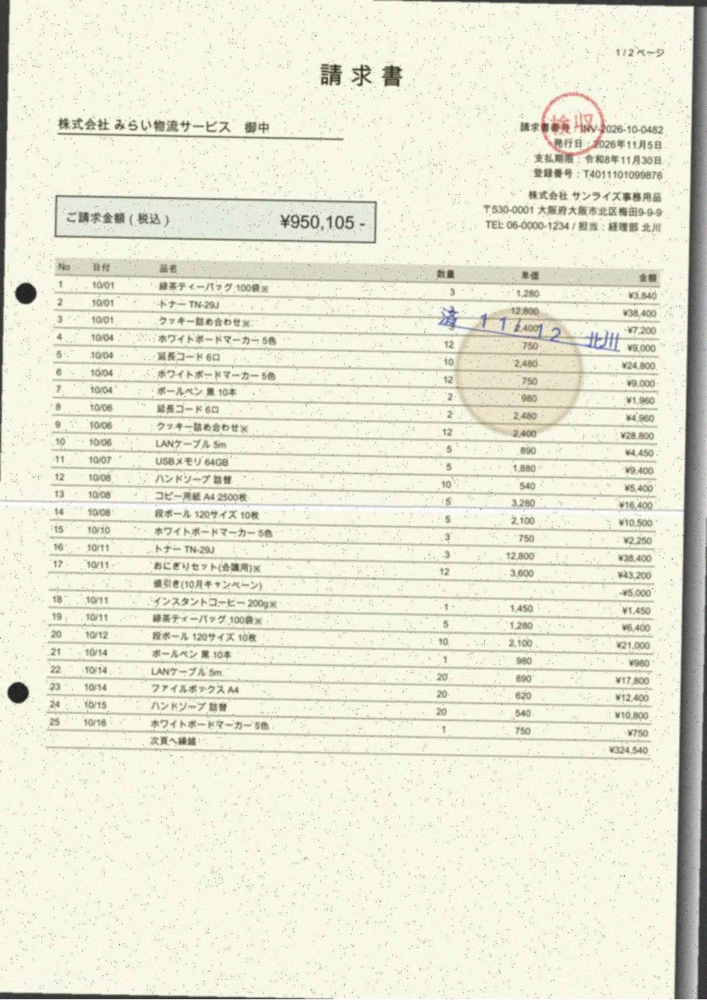
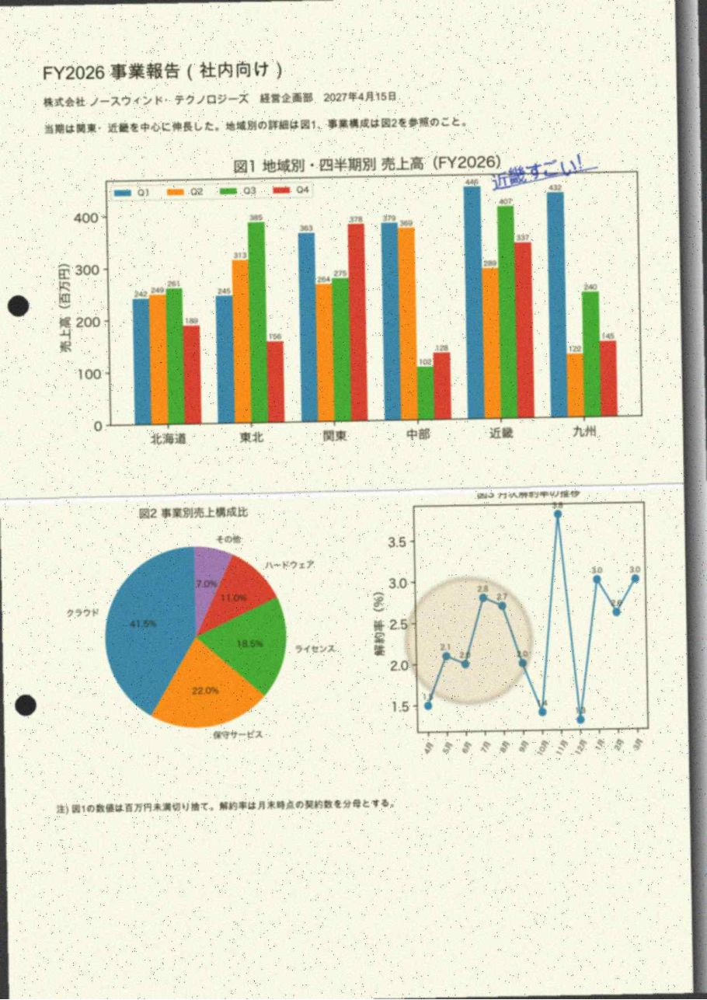
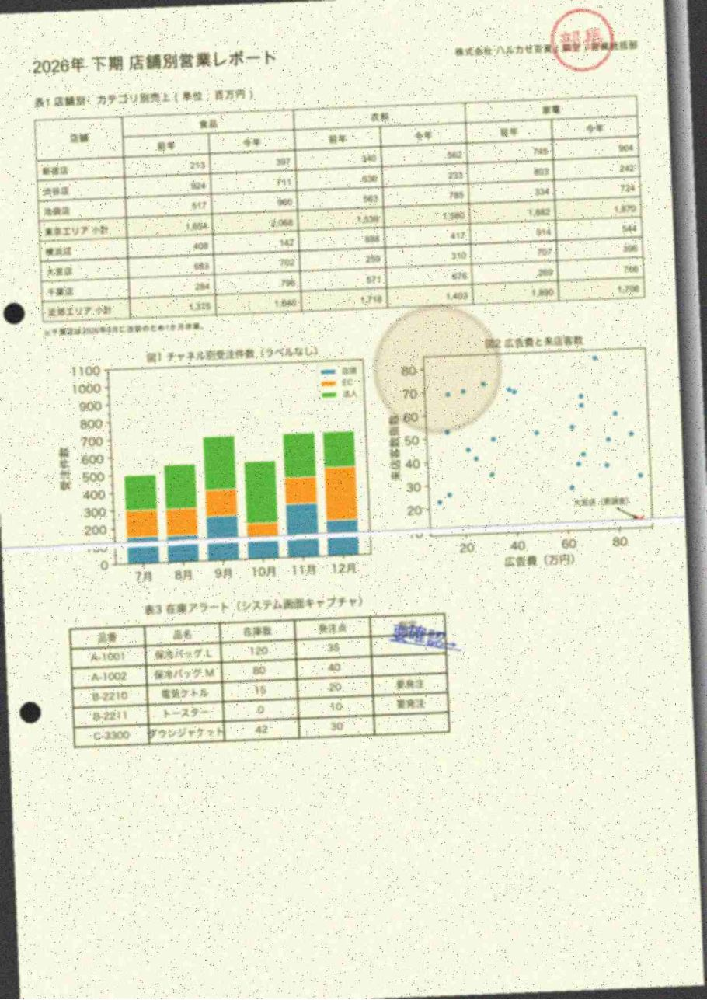
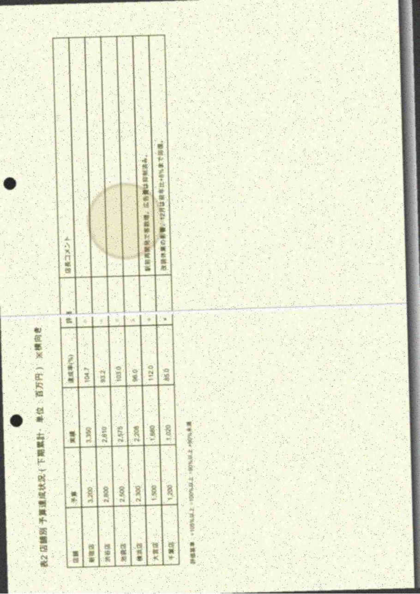
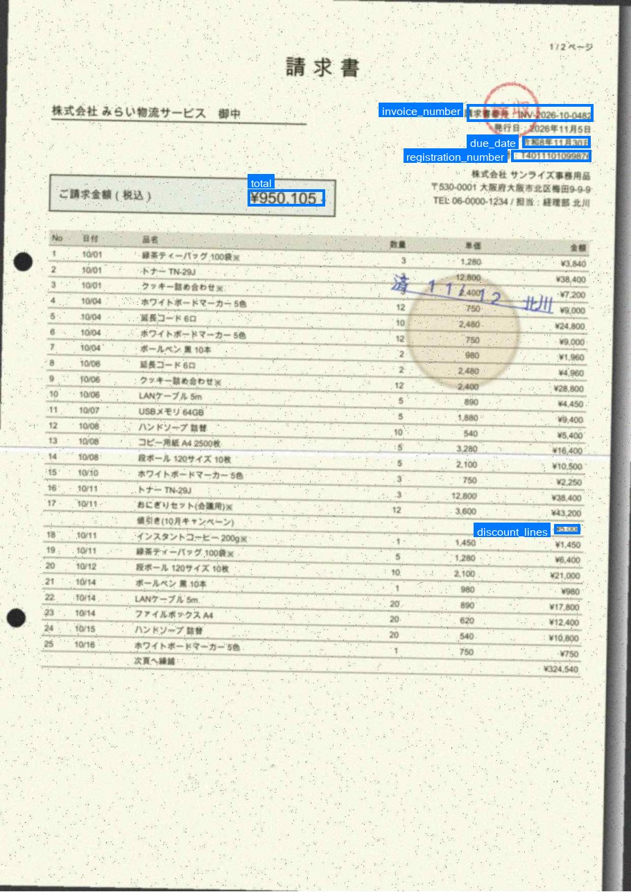
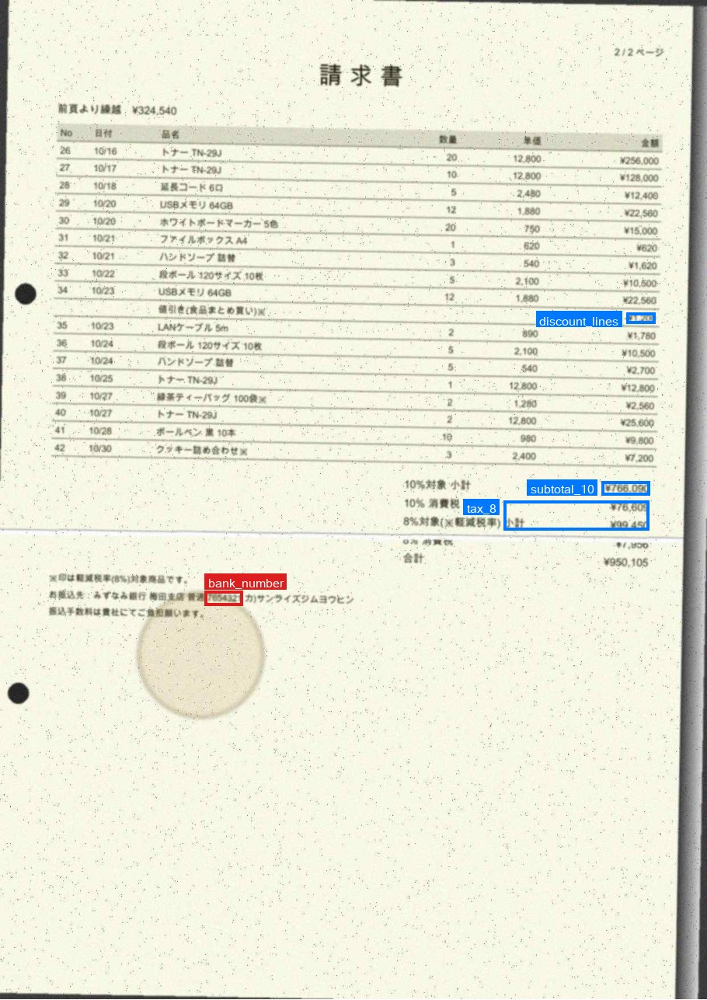
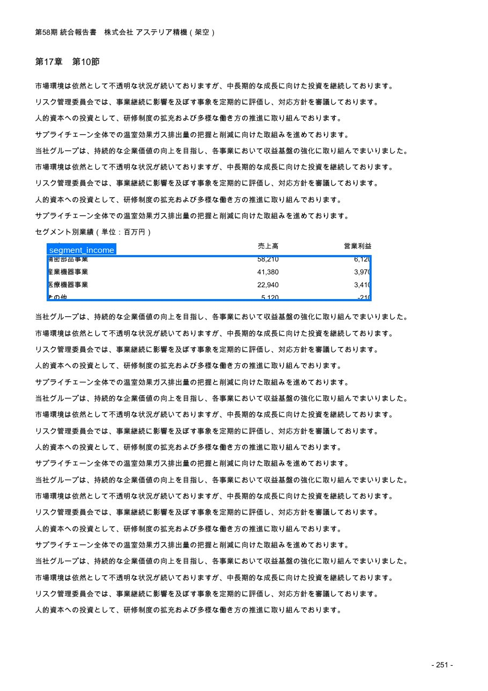

:::message
著者はSnowflakeに所属しておりますが、本記事は個人の見解であり、所属する組織の公式見解ではありません。
:::

2026年11月に、実はSnowflakeの[AI_EXTRACT](https://docs.snowflake.com/en/sql-reference/functions/ai_extract)関数へ精度改善と新機能がまとめて入っております。この記事では、その実力をわざと汚したスキャンPDFで確かめてみようと思います。

今回使用する書類は、シミや押印、手書きのメモ、意味不明な図表付きのものとなります。
きれいなPDFだけでは、元のAI_EXTRACTや各AIエージェントでも十分に業務で使えていたかと思いますので、敢えて人間の目ではみたくないドキュメントを使用しています。
あわせて、新機能のcitation（根拠の位置）とFL_FILTER_PAGES（ページ指定）も試しています。

## 1. はじめに

### AI_EXTRACT関数って何？

AI_EXTRACTは、テキストやファイルから欲しい情報をSQLだけで抜き出せる関数です。
PDFや画像を渡して「請求書番号は？」と聞くだけで、値が返ってきます。

```sql
SELECT AI_EXTRACT(
  file => TO_FILE('@ステージ', 'invoice.pdf'),
  responseFormat => {'invoice_number': '請求書番号'}
);
```

OCRの設定も、帳票ごとのテンプレート作成も要りません。

### 2026年11月のアップデート

11月だけで4回アップデートが入っています。

| 日付 | 内容 |
| --- | --- |
| 11月2日 | 精度改善（社内評価で12.8%の相対改善）。上限が125ページから1,000ページに拡大 |
| 11月10日 | FL_FILTER_PAGESで読むページを指定できるように |
| 11月18日 | `citation => TRUE` で抽出値の根拠の位置を返す（プレビュー） |
| 11月20日 | フィールド、リスト、表、複雑なレイアウトの精度改善（プレビュー） |

精度改善と1,000ページ対応は、クロスリージョン推論が有効なアカウントで適用されます。
SQLの書き方を変える必要はありません。

精度の内訳は、[Snowflakeのエンジニアリングブログ](https://docs.snowflake.com/en/release-notes/2026/other/2026-11-20-ai-extract-accuracy)で公開されています。
11のデータセットで、旧エンジンとの比較が次のとおり示されています。

| 抽出の種類 | 旧エンジン | 新エンジン |
| --- | --- | --- |
| 表 | 0.76 | 0.93 |
| リスト | 0.73 | 0.86 |
| 単一項目 | 0.86 | 0.95 |

全体的に精度が上昇していることが示されています。これは期待できますね。

同じブログでは、他社のサービスとの比較も公開されています。良かったらご覧になってください。

- [What's new](https://docs.snowflake.com/en/release-notes/new-features)
- [Nov 20, 2026: AI_EXTRACT accuracy](https://docs.snowflake.com/en/release-notes/2026/other/2026-11-20-ai-extract-accuracy)

:::message
今回の検証ポイント

- 汚れたスキャンでも項目や表を正しく抜けるか
- 図やグラフの中の数値まで読めるか
- citationで根拠の場所が分かるか
- 300ページの中から必要なページだけ読めるか
:::

## 2. 今回使うPDF

### 架空の書類をわざと汚す

検証用に、架空の書類をPythonで作りました。
それを画像に変換して、次の汚れを足しています。

- 紙の黄ばみ、コーヒーのシミ、折り目、パンチ穴
- 青ペンの手書きメモ、赤い押印
- 傾き、ぼかし、ノイズ、JPEGの劣化

テキストレイヤーは残していないので、純粋に「画像として」読ませています。

| ファイル | 内容 | 汚れ |
| --- | --- | --- |
| 請求書 | 2ページ42明細、番号なしの値引き行、軽減税率は※だけで表示、支払期限は和暦 | 中 |
| 売上レポート | 棒グラフ、円グラフ、折れ線グラフ。数値は図の中にしかない | 中 |
| 図表レポート | 数値ラベルなしの積み上げ棒、散布図、90度回転した表、画像として貼った表 | 強 |
| 年次報告書 | 300ページ。必要な情報は数ページにしか書かれていない | なし |

正解データはJSONで別に持っていて、抽出結果と突き合わせました。

汚した請求書はこんな感じです。



済印のメモが金額にかぶっていて、人間でもちょっと読みにくいですね。

### Snowflakeへの取り込み

まずクロスリージョン推論が有効か確認します。

```sql
SHOW PARAMETERS LIKE 'CORTEX_ENABLED_CROSS_REGION' IN ACCOUNT;
```

検証用のDBとステージを作って、PDFをアップロードします。

```sql
CREATE DATABASE IF NOT EXISTS AI_EXTRACT_TEST;
CREATE SCHEMA IF NOT EXISTS AI_EXTRACT_TEST.DOCS;
CREATE STAGE IF NOT EXISTS AI_EXTRACT_TEST.DOCS.PDFS
  DIRECTORY = (ENABLE = TRUE)
  ENCRYPTION = (TYPE = 'SNOWFLAKE_SSE');

-- SnowSQL等から
PUT file:///path/to/pdfs_dirty/*.pdf @AI_EXTRACT_TEST.DOCS.PDFS/dirty
  AUTO_COMPRESS = FALSE;
```

## 3. 検証① 請求書から項目を抜く

### 実装コード

質問を並べるだけです。
`scores` と `citation` もあわせて付けています。

```sql
SELECT AI_EXTRACT(
  file => TO_FILE('@AI_EXTRACT_TEST.DOCS.PDFS', 'dirty/01_invoice_dense_scan.pdf'),
  responseFormat => {
    'invoice_number': '請求書番号',
    'due_date': 'お支払期限（YYYY-MM-DD形式）',
    'registration_number': '登録番号',
    'subtotal_10': '10%対象の小計（税抜）',
    'tax_8': '8%対象の消費税額',
    'total': 'ご請求金額合計',
    'bank_number': '振込先の口座番号',
    'discount_lines': '値引き行の金額をすべて',
    'reduced_tax_item_count': '軽減税率(※)対象の明細行は何行あるか'
  },
  scores => TRUE,
  citation => TRUE
) AS r;
```

### 結果と考察

| 判定 | 項目 | 抽出結果 | 正解 | score |
| --- | --- | --- | --- | --- |
| ✅ | 請求書番号 | INV-2026-10-0482 | （同左） | 0.78 |
| ✅ | 支払期限 | 2026-11-30 | （同左） | 0.84 |
| ✅ | 登録番号 | T4011101099876 | （同左） | 0.73 |
| ✅ | 10%小計 | ¥766,090 | （同左） | 0.78 |
| ✅ | 8%税額 | ¥7,956 | （同左） | 0.36 |
| ✅ | 合計 | ¥950,105 | （同左） | 0.87 |
| ✅ | 値引き行 | -¥5,000, -¥1,200 | （同左） | 0.47 |
| ✅ | 口座番号 | 7854321 | 7854321 | 0.78 |
| ❌ | ※の行数 | 11 | 9 | 0.36 |

9項目中8項目が正解でした。

支払期限は「令和8年11月30日」と書いてあるのを、指示どおり西暦に変換してくれています。
2ページ目にある番号なしの値引き行も、ちゃんと拾えていました。

外れたのは1つです。
※の行数は、中々意地悪なんですが明細を数えさせる集計の問いでした。scoreも0.36と低めです。
このscoreも併用しつつ当たりをつけてレビューしていく仕組みも作れそうですね。

:::message
scoreが低い項目は間違いやすい傾向がありました。
この点は、後半のcitationで補えます。
:::

## 4. 検証② 図とグラフから数値を読む

### 売上レポート

棒グラフは表として、円グラフはリストとして抜きます。
JSONスキーマ形式で書くと、表・リスト・文字列を1回でまとめて取れます。

```sql
SELECT AI_EXTRACT(
  file => TO_FILE('@AI_EXTRACT_TEST.DOCS.PDFS', 'dirty/03_sales_report_charts_scan.pdf'),
  responseFormat => {
    'schema': {
      'type': 'object',
      'properties': {
        'region_sales': {
          'description': '地域別・四半期別売上の棒グラフ（百万円）',
          'type': 'object',
          'column_ordering': ['region', 'Q1', 'Q2', 'Q3', 'Q4'],
          'properties': {
            'region': {'description': '地域', 'type': 'array'},
            'Q1': {'description': 'Q1', 'type': 'array'},
            'Q2': {'description': 'Q2', 'type': 'array'},
            'Q3': {'description': 'Q3', 'type': 'array'},
            'Q4': {'description': 'Q4', 'type': 'array'}
          }
        },
        'segment_share': {
          'description': 'セグメント別構成比の円グラフの各セグメント名と割合%を「名前:割合」形式で',
          'type': 'array'
        },
        'max_churn_month': {
          'description': '解約率の折れ線グラフで最も解約率が高い月とその値',
          'type': 'string'
        }
      }
    }
  },
  scores => TRUE,
  citation => TRUE
) AS r;
```



結果は全問正解でした。

- 棒グラフ：6地域×4四半期の24値すべて
- 円グラフ：5区分の構成比すべて
- 折れ線グラフ：解約率が最大の月（11月、3.8%）

実際に返ってきた値は次のとおりです。

棒グラフ（地域別・四半期別売上、百万円）

| 判定 | 地域 | Q1 | Q2 | Q3 | Q4 |
| --- | --- | --- | --- | --- | --- |
| ✅ | 北海道 | 242 | 249 | 261 | 189 |
| ✅ | 東北 | 245 | 313 | 385 | 156 |
| ✅ | 関東 | 363 | 264 | 275 | 378 |
| ✅ | 中部 | 379 | 369 | 102 | 128 |
| ✅ | 近畿 | 446 | 289 | 407 | 337 |
| ✅ | 九州 | 432 | 122 | 240 | 145 |

円グラフ（セグメント別構成比）

| 判定 | セグメント | 構成比 |
| --- | --- | --- |
| ✅ | クラウド | 41.5% |
| ✅ | 保守サービス | 22.0% |
| ✅ | ライセンス | 18.5% |
| ✅ | ハードウェア | 11.0% |
| ✅ | その他 | 7.0% |

折れ線グラフ（解約率が最大の月）は `11月 3.8` でした。
scoreは棒グラフが0.7、円グラフが0.87、折れ線グラフが0.57です。

棒グラフには数値ラベルが付いているので、読みやすい部類ではあります。
それでも、手書きメモがグラフに重なっているのに値を取り違えていないのはすごいですね。

### 図表レポート

もっと意地悪にしたのがこちらです。
汚れを一段階強くしています。



2ページ目には、90度回転した表があります。



結果はこうなりました。

| 判定 | 対象 | 結果 | score |
| --- | --- | --- | --- |
| 🔺 | 90度回転した表（6店舗×5列） | 30セル中29セルが正解 | 0.32 |
| ✅ | 画像として貼った在庫表 | 全セル正解 | 0.78 |
| ✅ | 散布図の外れ値の注記 | 正解（大宮店） | 0.27 |
| 🔺 | 数値ラベルのない積み上げ棒 | 18値中10値が正解 | 0.27 |

✅は全問正解、🔺は一部正解です。
回転した表も、画像の表も、ほぼ完璧に読めています。
回転表で外れたのは、渋谷店の予算（2,800を2,600）の1セルだけでした。
◎○△×の評価記号まで正しく取れています。

苦手だったのは、数値ラベルのないグラフを目盛りから読むことです。
積み上げ棒の一番下の系列は全部正解でしたが、上に積まれた系列は10〜50ずれました。
これは人間でも目盛りを指でなぞりたくなるやつなので、、まあ、、許してあげましょう。
正直正解が何なのか目測では分かりません。笑

:::message
図表のポイント

- 表は回転していても、画像で貼られていても強い
- 数値ラベルのあるグラフは問題なく読める
- 目盛りから値を読ませるのは苦手
:::

## 5. 検証③ citationで根拠の場所を確認する

11月18日に入った新機能です。
`citation => TRUE` を付けると、抽出値がどこに書いてあったかをページと座標で返してくれます。

```json
"total": [{"page": 1, "upper_left": [39.3, 21.3], "lower_right": [51.5, 23.1]}],
"bank_number": [{"page": 2, "upper_left": [29.0, 59.1], "lower_right": [34.3, 60.5]}]
```

座標は、ページの幅と高さに対するパーセントです。
SQLで行に展開すると扱いやすくなります。

```sql
SELECT f.key AS field,
       c.value:page::INT AS page,
       c.value:upper_left AS upper_left,
       c.value:lower_right AS lower_right
FROM AI_EXTRACT_TEST.DOCS.R01 t,
     LATERAL FLATTEN(INPUT => t.r:citations.bounding_boxes) f,
     LATERAL FLATTEN(INPUT => f.value) c
ORDER BY page, field;
```

この座標を、そのまま画像に枠として描いてみました。
青は正解した項目、赤は読み間違えた口座番号です。





ほとんどの枠が、該当する値をきっちり囲んでいます。
8%税額だけは、本来の行より1〜2行上を指していました。
本来の行は折り目の線にかかっていました。値自体は正解です。

:::message
間違えた8%税額の行番号も、citationがあれば一瞬で確認できます。
人は枠の場所だけ見ればいいので、全項目を目視する必要がなくなります。
:::

citationの精度そのものは、澁井さんの記事で詳しく検証されています。
正解の座標を持つ文書を使い、citationが正解の位置を指すかを数値で評価しています。

https://zenn.dev/snowflakejp/articles/48c3197d776e5f

この記事でも、citationが正しい値の正確な位置を返す例が多く示されています。
一方で、次のような注意点も挙げられています。

- 複数行の住所では、隣の欄まで枠が広がることがある
- 透かしが重なった値では、値は正しくてもcitationが空になることがある
- 値を誤ったときも、citationはその誤った値の位置を正確に指す

今回の口座番号も、3つ目と同じ状況でした。
citationは値の正しさを保証するものではなく、人が確認しやすくするための情報です。

## 6. 検証④ 300ページから必要なページだけ読む

11月10日に入ったFL_FILTER_PAGESを使います。
300ページの年次報告書から、97ページ目と251ページ目だけを読ませてみました。

```sql
SELECT AI_EXTRACT(
  file => FL_FILTER_PAGES(
    TO_FILE('@AI_EXTRACT_TEST.DOCS.PDFS', 'clean/05_long_annual_report_300p.pdf'),
    [{'start': 96, 'end': 97}, {'start': 250, 'end': 251}]
  ),
  responseFormat => {
    'new_factory': '新工場の建設予定地と稼働開始時期',
    'segment_income': 'セグメント別の営業利益をすべて「セグメント名:金額」で'
  },
  citation => TRUE
) AS r;
```

ページ番号は0始まりで、`end` は含みません。
ちょっとクセがあるので注意です。

```json
{
  "new_factory": "熊本県菊池郡大津町、2028年3月",
  "segment_income": "精密部品事業:6,120, 産業機器事業:3,970, 医療機器事業:3,410, その他:-210"
}
```

どちらも正解でした。
citationのページは97と251で返ってきて、元のPDFのページ番号と一致しています。



## 7. コストの考え方

AI_EXTRACTは、ページ数と入出力のトークン数で課金されます。
PDFは1ページあたり970トークンとして数えられます。

今回の記事で読んだのは、合計7ページです。

| ファイル | ページ数 |
| --- | --- |
| 請求書 | 2 |
| 売上レポート | 1 |
| 図表レポート | 2 |
| 年次報告書（FL_FILTER_PAGESで2ページのみ） | 2 |

300ページを丸ごと読むと、ページ分だけで約29万トークンです。
FL_FILTER_PAGESで2ページに絞れば、約2,000トークンで済みます。
長い文書ほど、この差は効いてきます。

なお、scoreとcitationは追加料金なしで使えます。
今回の精度改善でも、料金は変わっていません。
精度が上がった分、同じコストで任せられる範囲が広がったことになります。

## 8. まとめ

今回、わざと汚したスキャンPDFでAI_EXTRACTを試してみました。

特に印象的だったのは、90度回転した表や画像で貼られた表を、汚れの上からほぼ完璧に読めたことです。
和暦の変換や、番号のない値引き行の拾い上げも、何も特別なことをせずにこなしてくれました。

一方で、目盛りから値を読むグラフや、行数を数えさせる問いは外れやすい印象です。
scoreが低いものは疑ってかかる、という使い方がよさそうでした。

そして今回のアップデートで入ったcitationは大きいです。
「AIが読んだ値、本当に合ってる？」を、根拠の場所を見て確かめられるようになりました。
業務で使うなら、scoreで怪しいものを絞り、citationで人が確認する。
この組み合わせが現実的だと思います。

紙の書類のデータ化で困っている方は、ぜひ一度試してみてください。
意外と「え、これ読めるの？」ってなると思います。

それでは、ぜひ感想をお待ちしております！ありがとうございました。

## 参考記事

- [AI_EXTRACT SQLリファレンス](https://docs.snowflake.com/en/sql-reference/functions/ai_extract)
- [Nov 20, 2026: AI_EXTRACT accuracy](https://docs.snowflake.com/en/release-notes/2026/other/2026-11-20-ai-extract-accuracy)
- [Improving document extraction quality in Snowflake AI_EXTRACT](https://www.snowflake.com/en/blog/engineering/ai-extract-document-extraction-quality/)
- [Snowflake AI_EXTRACT の Citations（Preview機能）を使ったドキュメントの出典位置読み取り](https://zenn.dev/snowflakejp/articles/48c3197d776e5f)
