:::message
著者はSnowflakeに所属しておりますが、本記事は個人の見解であり、所属する組織の公式見解ではありません。

:::

## はじめに

こんにちは。Snowflakeでソリューションエンジニアをしている渡利です。

前回の記事では、CoCo DesktopからSnowflake AIMを使い、Amazon Redshiftからの移行を試しました。

https://zenn.dev/snowflakejp/articles/snowflake-aim-redshift-iceberg

今回は、Snowflake AIMのデスクトップアプリである **Snowflake AIM for Data Warehouses** を使い、Teradataからの移行を検証しました。Teradataからの移行デモを準備するにあたり、アプリでどこまで進められるかを確かめたかったためです。

移行対象は、Teradataのテーブル、ビュー、マクロ、ストアドプロシージャ、ユーザー定義関数です。コード変換からデプロイ、データ移行、データ検証、テストまでを1日で通しました。前半ではアプリの画面に沿って操作の流れを紹介し、後半では移行の途中で見つかった問題とAIMの対処をまとめます。

:::message alert
製品仕様の説明は2026年11月25日時点の公開ドキュメントに基づきます。検証は2026年10月25日に、アプリのバージョン0.0.1+8eee（2026年10月20日ビルド）で実施しました。画面や挙動は今後変わる可能性があります。

:::

## 結論

検証して分かったことを、先にまとめます。

- AIMアプリで、Teradataの26オブジェクトをSnowflakeへ移行できました。変換、デプロイ、データ移行、データ検証、テストまでを通し、私が実際に作業したのは2時間ほどです。
- 接続の設定は、質問カードに答えるだけで済みました。システム用のデータベースが混ざっていても、AIM Agentが気づいて移行対象を絞り込みます。
- SnowConvertの判定は、26件中24件が Success でした。それでも、デプロイとテストの段階で動的SQLの引数の欠落やPERIOD型のロード失敗が見つかり、AIM Agentが修正しています。
- テーブルのデータは、行数と統計値でTeradataとの一致を確認しました。テストの仕組みで比べられないものは、手動の照合と私の承認で完了にしています。
- 公開ドキュメントの対応表では、Teradataのコード抽出、AIによる変換と検証、デプロイがまだ Planned です。本番で使う前に最新の状況を確認し、検証には移行元の複製環境を使うのが安全です。本番規模のデータは、S3を経由する `write_nos` で移す構成が一般的です。

## Snowflake AIM for Data Warehousesアプリとは

Snowflake AIMは、既存のデータ基盤をSnowflakeへ移すための製品群です。Teradataの仮想化、データウェアハウスの移行、Sparkワークロードのモダナイゼーションの3つの経路があります。

https://docs.snowflake.com/en/migrations/snowflake-aim

データウェアハウスの移行を担うのが、Snowflake AIM Agent for Data Warehouses（以下、AIM Agent）です。移行元への接続から、コードの抽出と変換、アセスメント、デプロイ、データ移行、検証までを対話で進めます。SnowConvertによる決定論的な変換を土台にして、残った問題の修正やテストをAIが支援します。

https://docs.snowflake.com/en/migrations/aim-for-datawarehouses/overview

今回使ったSnowflake AIM for Data Warehousesアプリ（以下、AIMアプリ）は、AIM AgentをGUIで使うためのデスクトップアプリです。macOS版とWindows版があり、クイックスタートのページからダウンロードできます。

https://docs.snowflake.com/en/migrations/aim-for-datawarehouses/quick-start

クイックスタートに記載された前提条件は、次の4つです。

- Python
- Git
- Snowflake CoCo CLI
- Snowflake CLI

初回起動時には、Snowflake接続を選びます。アプリは、その接続でCoCoを使えるかを確認してから先へ進みます。

画面は、左側に工程のチェックリスト、右側にAIM Agentとの会話が並ぶ構成です。AIM Agentからの質問は、選択肢付きのカードで1問ずつ表示されます。移行専用の画面で、今どの工程にいるかを確認しながら進められる点が、前回のCoCo Desktopとの違いです。

## 今回試した構成

| 項目 | 内容 |
| --- | --- |
| アプリ | Snowflake AIM for Data Warehouses 0.0.1+8eee（macOS） |
| 移行元 | Teradata 20.0（Teradataのトライアル環境） |
| 移行対象 | `AIM_SRC` データベースの26オブジェクト |
| 変換エンジン | SnowConvert AI 2.51.1 |
| 移行先 | Snowflakeの `SNOWFLAKEAIM_TERA` データベース（ネイティブテーブル） |
| データ移行 | 抽出方式はODBC、OrchestratorとWorkerはローカル |

移行対象の内訳は、スキーマ1件、テーブル8件、ビュー7件、ストアドプロシージャ6件、マクロ2件、ユーザー定義関数2件です。データは8テーブルで合計9,547行と小さく、移行の流れと変換の結果を確かめるための構成です。

## AIMアプリでTeradataからの移行を進める

### 1. プロジェクトを作り、移行元にTeradataを選ぶ

新しいプロジェクトを作ると、AIM Agentがセットアップの質問を始めます。最初のカードでは、移行元の種類、コードの取得方法、ETLやBIなどの追加対象、変換設定を順に聞かれます。

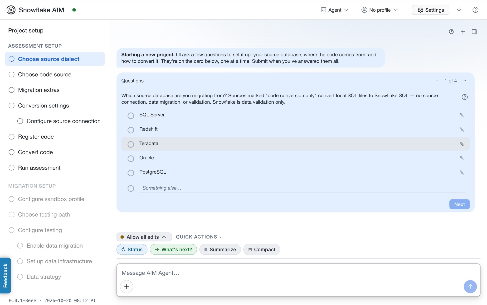

今回は移行元にTeradataを選び、コードは移行元のデータベースから直接抽出する方式にしました。

左側のチェックリストは、アセスメントまでの準備（ASSESSMENT SETUP）と、移行の準備（MIGRATION SETUP）の2段に分かれています。回答が進むと、各項目にチェックが付いていきます。

### 2. 接続情報は質問カードに答えて登録する

次は、移行元のTeradataへの接続設定です。認証方式、ホスト名、データベース名、ユーザー名、ポート番号を、カードで1つずつ答えます。

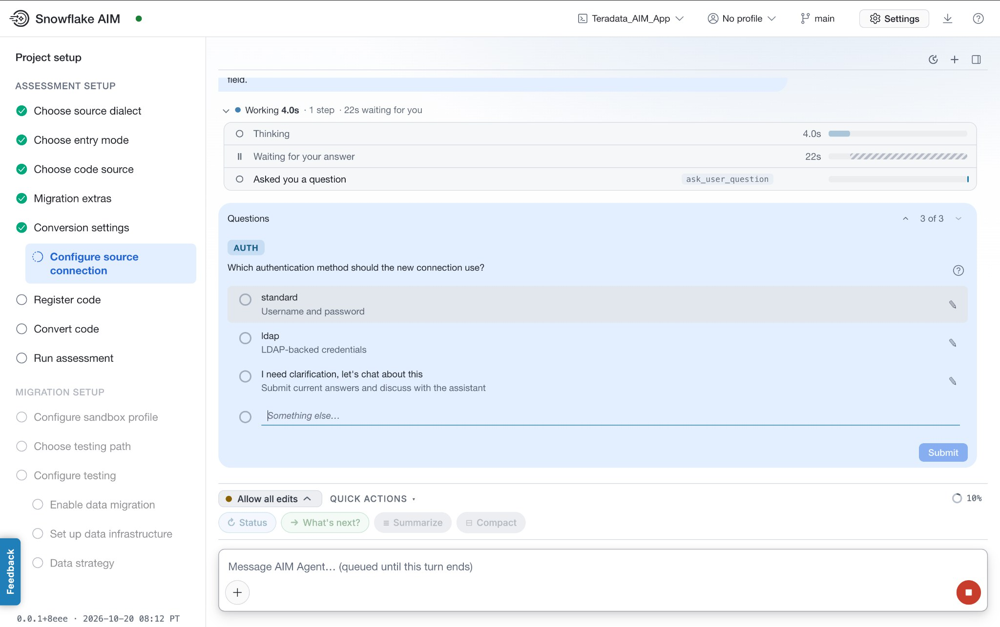

認証方式は、ユーザー名とパスワードで認証する `standard` を選びました。

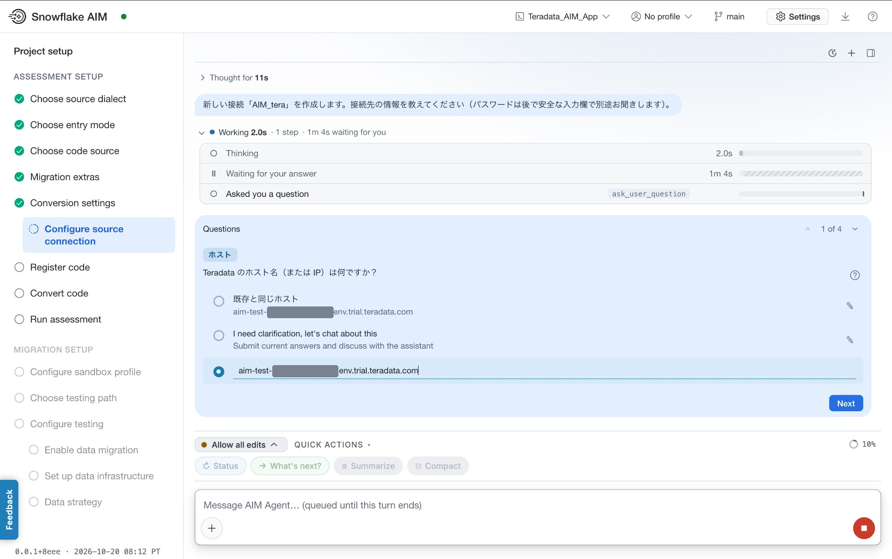

同じマシンに既存のTeradata接続があったため、AIM Agentはそのホストを候補として出してくれました。画像のホスト名は一部をマスクしています。

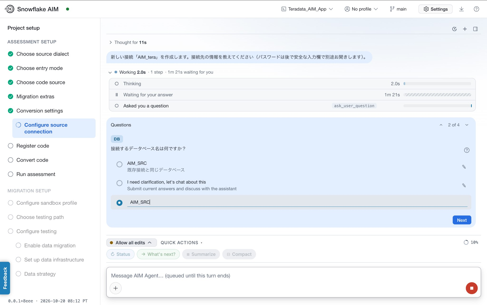

データベース名には `AIM_SRC` を指定しました。

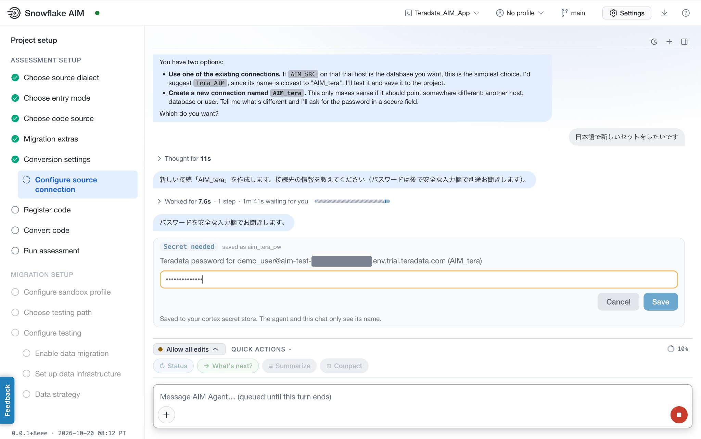

パスワードは、会話とは別の専用の欄で入力します。欄の下には「Saved to your cortex secret store. The agent and this chat only see its name.」と表示されています。値はシークレットストアに保存され、AIM Agentと会話に残るのはシークレットの名前だけです。

この画面の上部では、AIM Agentが既存の接続を使うか、新しく作るかを確認しています。日本語で「新しい接続を作りたい」と返すと、以降の質問も日本語に切り替わりました。最後に接続テストが成功し、プロジェクトの移行元として保存されました。

### 3. システム用DBの混在をAIが検知し、範囲を絞り込む

接続できたら、移行元からオブジェクトを抽出してプロジェクトに登録します。最初の抽出では226件を対象に、196件を抽出して30件が失敗しました。失敗した30件はすべてTeradataが用意しているデータベースの関数で、権限不足やSHOW操作の制限によるエラーでした。

抽出できた196件のうち、`AIM_SRC` のものは27件だけです。残りの大半は、`tdwm` や `val` のようにTeradataが用意しているデータベースのものでした。AIM Agentはこの混在に気づき、移行対象をどの範囲にするかを聞いてきました。

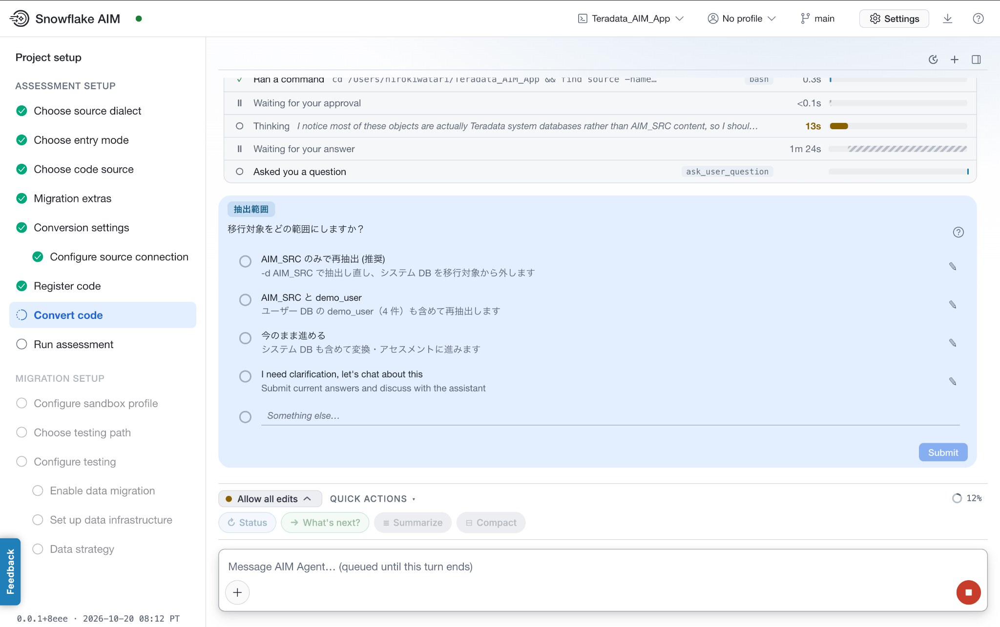

選択肢は「AIM_SRC のみで再抽出（推奨）」「AIM_SRC と demo_user」「今のまま進める」の3つです。推奨のとおり、`AIM_SRC` のみを選びました。

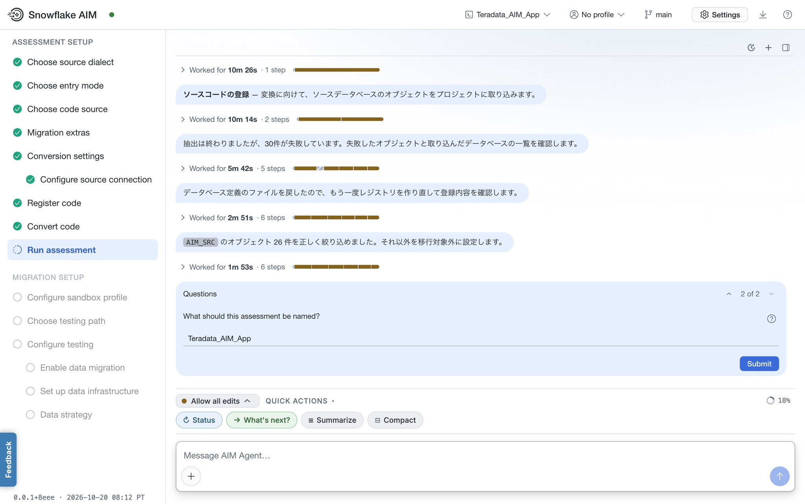

AIM Agentは `AIM_SRC` だけを抽出し直し、26件に絞り込みました。それ以外のオブジェクトは、移行対象外として扱われます。

Teradataには、`DBC` や `SYSLIB` のように移行の必要がないシステム用のデータベースが多数あります。今回のトライアル環境にも、ワークロード管理（`tdwm`）や機械学習関連（`mldb`）のデータベースがありました。抽出範囲を人が細かく指定しなくても、AIM Agentが混在に気づいて確認してくれる点は助かりました。

### 4. アセスメントで移行の全体像をつかむ

コード変換のあとは、アセスメントに進みます。アセスメントでは、移行のWaveとHTMLのレポートが必ず作られます。追加の分析は、カードで選べます。

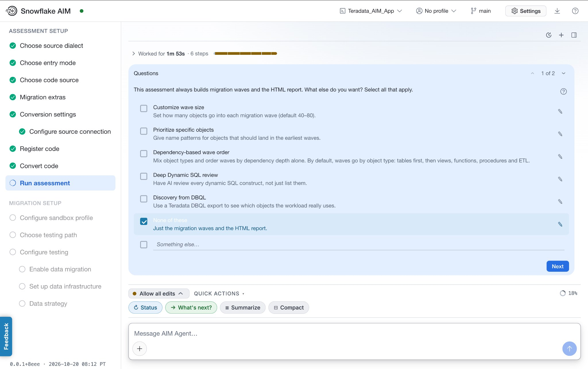

選べる分析は、次の5つです。

- Waveに入れるオブジェクト数の変更（既定は40〜80件）
- 先に移行したいオブジェクトの指定
- 依存関係の深さに基づくWaveの並べ替え
- AIによる動的SQLの詳細レビュー
- DBQLのエクスポートを使った利用状況の把握

今回は追加の分析を選ばず、WaveとHTMLのレポートだけにしました。DBQLはTeradataのクエリログです。実際の移行では、実際に使われているオブジェクトを把握して対象を絞る用途で役立ちそうです。

完成したアセスメントのレポートが次の画面です。

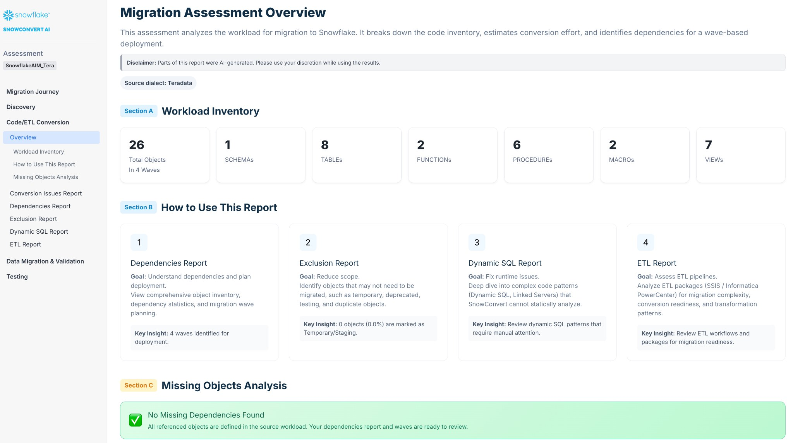

26オブジェクトが4つのWaveに分けられ、種類ごとの件数が並びます。参照先が移行元に見つからないオブジェクトはありませんでした（No Missing Dependencies Found）。依存関係、除外候補、動的SQL、ETLの各レポートも、同じ画面から開けます。

### 5. 移行セットアップで実行環境を決める

アセスメントが終わると、移行のセットアップ（MIGRATION SETUP）に進みます。最初に、サンドボックスのプロファイル名を決めます。

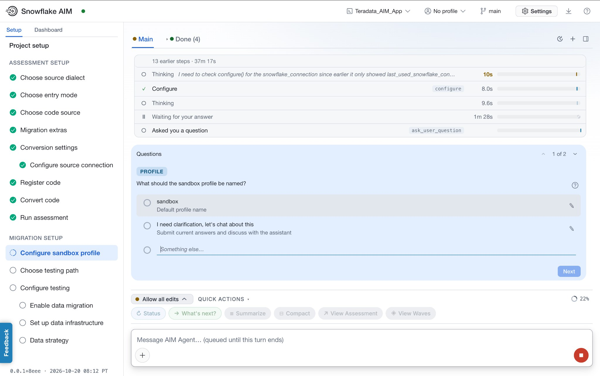

サンドボックスのプロファイルは、移行元の接続と移行先のSnowflake接続を組み合わせた設定です。今回は既定の `sandbox` にしました。続けて、移行先のSnowflake接続と、移行元のデータベースの対応付けを選びます。

その後は、テストの方法、データ移行の有無、OrchestratorとWorkerの配置、データ移行の方式を順に決めます。OrchestratorとWorkerの配置先は、ローカルとSnowpark Container Services（SPCS）から選べます。今回の設定は次のとおりです。

| 項目 | 設定 |
| --- | --- |
| テストに使うデータ | 移行元データベースの実データ |
| データ移行の種類 | 全件移行 |
| 抽出方式 | ODBC |
| 移行先のテーブル | ネイティブテーブル |
| OrchestratorとWorker | ローカル |

ODBCによる抽出は、公開ドキュメントの `regular` に当たります。WorkerがTeradataにSELECTを発行し、受け取ったデータをParquetに変換してSnowflakeの内部ステージへアップロードする方式です。今回は検証用でデータが小さいため、この方式を使いました。

#### 本番規模ではS3を経由する構成が一般的

本番規模のデータを移す場合は、S3などのオブジェクトストレージを経由する構成が一般的です。AIMでは、`write_nos` という抽出方式がこれに当たります。TeradataのWRITE_NOSでS3へParquetを書き出し、Snowflakeは外部ステージからロードします。

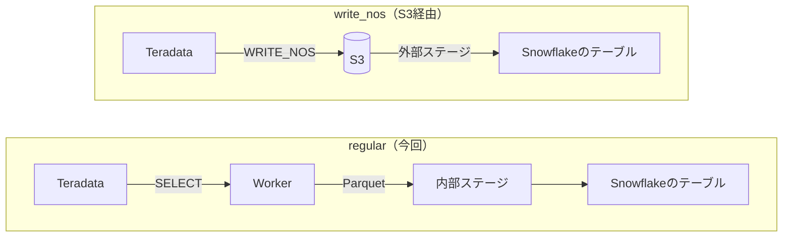

| 抽出方式 | データの流れ | 向いている場面 |
| --- | --- | --- |
| `write_nos`（S3経由） | TeradataがS3へ書き出し、Snowflakeが外部ステージからロードする | 本番規模の移行 |
| `regular`（今回） | Workerが受け取ったデータを内部ステージへアップロードする | 少量のデータ、S3の準備が整う前 |

公開ドキュメントでも、前提が整っていれば、すべてのテーブルに `write_nos` を使うよう推奨しています。`regular` は、データ量が少ない場合や、`write_nos` の準備がまだ整っていない場合の選択肢という位置付けです。`write_nos` ではデータがTeradataからS3へ直接書き出され、Workerのマシンを経由しません。前回のRedshiftの記事で紹介した「UNLOAD to S3」と同じ考え方です。

`write_nos` を使うには、次の準備が必要です。

- Teradata側でNOS（Native Object Store）とWRITE_NOSを使えるようにする
- Teradataが書き込むS3バケットと、書き込み用の認証情報を用意する
- 同じバケットを指すSnowflakeの外部ステージを作る
- WorkerとワークフローにWRITE_NOS用の設定を入れる

書き出し先には、S3のほかAzure Blob StorageとGoogle Cloud Storageも使えます。外部ステージの作成は、AIM Agentに手伝ってもらえます。公式ドキュメントには、次のプロンプトの例が載っています。

```text:AIM Agentへのプロンプトの例（公式ドキュメントより）
Set up Teradata data migration using write_nos extraction for all tables and help me create the matching Snowflake external stage
```

なお、Teradata Parallel Transporter（TPT）を選んだ場合も、Workerで抽出して内部ステージへアップロードする点は `regular` と同じです。

https://docs.snowflake.com/en/migrations/aim-for-datawarehouses/data-migration-validation/migrate-teradata

### 6. ダッシュボードで工程ごとの進捗を見る

移行が始まると、ダッシュボードで工程ごとの進捗を確認できます。次の画面は、すべてのWaveを終えた時点のものです。

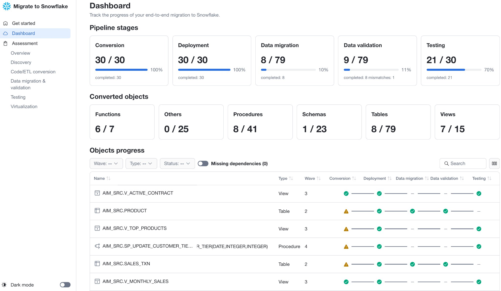

上段の Pipeline stages に、変換、デプロイ、データ移行、データ検証、テストの5工程が並びます。数字を読むときは、次の点に注意が必要です。

- 分母には、移行対象外にしたオブジェクトも含まれる（テーブルは79件）
- 移行対象は、SnowConvertが生成した補助用のUDF 4件を加えた30件
- テーブルとスキーマはテストの対象外で、Testingの21件はテスト対象のすべて
- Data validationの不一致1件は、後述するCUSTOMERテーブルの結果

下段の Objects progress では、オブジェクトごとに種類、Wave、各工程の状態を一覧できます。警告マークは課題付きで変換されたもの、横棒は対象外の工程です。

### 7. オブジェクト単位で課題と依存関係を追う

一覧からオブジェクトを開くと、そのオブジェクトの工程、課題、依存関係がまとめて表示されます。次の画面は `AIM_SRC.PRODUCT` テーブルの詳細です。

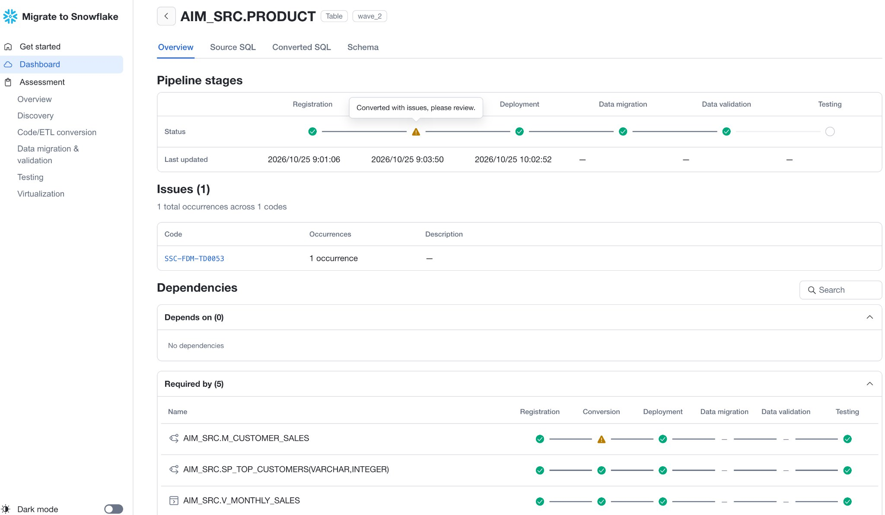

画面からは、次の情報を読み取れます。

- 登録からテストまでの工程ごとの状態と更新時刻
- 変換時の課題（Issues）
- このオブジェクトが参照するもの（Depends on）と、参照されているもの（Required by）

変換の工程には警告マークが付き、「Converted with issues, please review.」と表示されています。課題は `SSC-FDM-TD0053` の1件です。Teradataの列属性 `UPPERCASE` がSnowflakeにないことを知らせる通知で、DML側の `UPPER()` で代替します。`PRODUCT_CODE` 列が `UPPERCASE` 付きで定義されていたため、この通知が出ました。

`Required by` には、`PRODUCT` を参照する5つのオブジェクトがあります（画面は先頭の3件）。

- `M_CUSTOMER_SALES`（マクロ）
- `M_DISCONTINUE_PRODUCT`（マクロ）
- `SP_TOP_CUSTOMERS`（プロシージャ）
- `V_MONTHLY_SALES`（ビュー）
- `V_TOP_PRODUCTS`（ビュー）

参照元ごとの進捗も同じ表で追えるため、テーブル定義を変えるときの影響範囲をすぐに確認できます。AIMはこの依存関係をもとにWaveを組み、参照先のテーブルを先にデプロイします。上部の `Source SQL` と `Converted SQL` のタブでは、変換前後のSQLを見比べられます。

### 8. 移行元と移行先のオブジェクトを比べる

最後に、TeradataとSnowflakeのオブジェクトの一覧を並べました。

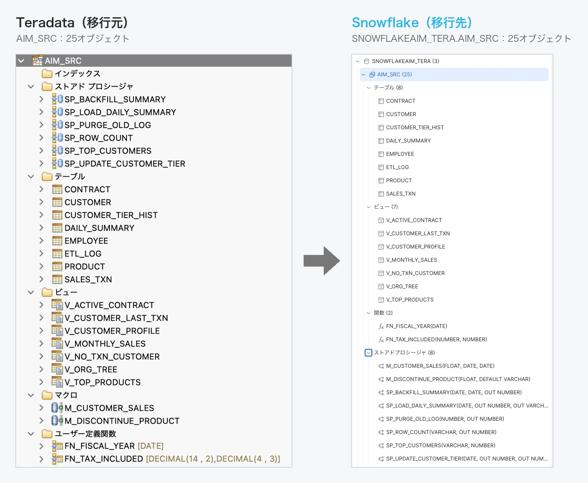

| 種類 | Teradata | Snowflake |
| --- | ---: | ---: |
| テーブル | 8 | 8 |
| ビュー | 7 | 7 |
| ストアドプロシージャ | 6 | 8 |
| マクロ | 2 | 0 |
| ユーザー定義関数 | 2 | 2 |
| 合計 | 25 | 25 |

Snowflakeにはマクロがないため、マクロの2件はストアドプロシージャに変換されています。このほか、SnowConvertが生成した補助用のUDF 4件が `PUBLIC` スキーマにあります。

移行対象の30件は、すべて完了の状態になりました。ただし、一部は自動テストの代わりに、手動の照合と例外の承認で完了にしています（後述）。プロジェクトの作成から最後のオブジェクトの完了までの経過時間は約7時間半です。ただ、休憩やAIM Agentの作業を待つ時間を除くと、私が実際に作業したのは2時間ほどでした。

## 検証結果の詳細

### SnowConvertの変換結果

SnowConvertのレポートでは、26件中24件が Success、2件が Partial でした。変換サマリーの Overall conversion は92.31%です。Partialの2件は、`SSC-EWI-0073`（機能的に同じかの確認が必要）が出た `V_TOP_PRODUCTS` と `SP_BACKFILL_SUMMARY` です。

そのほかの通知は次のとおりです。FDMは機能差の通知、PRFは性能面の注意を表します。

| コード | 件数 | 内容 |
| --- | ---: | --- |
| SSC-FDM-TD0040 | 4 | 列のFORMAT句は未対応のため、DML側の変換関数で代替する |
| SSC-FDM-TD0024 | 2 | SET TABLEの重複排除は未対応のため、重複行が入りうる |
| SSC-FDM-TD0053 | 1 | 列のUPPERCASE属性は未対応のため、DML側のUPPER()で代替する |
| SSC-FDM-TD0043 | 1 | SIGNALの動的なメッセージは未対応のため、CUSTOM_SQLERRMで代替する |
| SSC-FDM-0020 | 1 | 複数の結果セットを一時テーブルで返す |
| SSC-FDM-0038 | 1 | マイクロパーティションはSnowflakeが自動で管理する |
| SSC-PRF-0004 | 1 | カーソルのFORループを使っている |

FDMやPRFはエラーではありません。ただし、`SSC-FDM-TD0024` のように業務上の前提に関わるものもあります。SET TABLEで重複行を防いでいた場合は、ロード処理の側で重複を防ぐ設計が必要です。

各コードの詳細は、公式ドキュメントで確認できます。

https://docs.snowflake.com/en/migrations/aim-for-datawarehouses/code-conversion/issues-and-troubleshooting/functional-difference/teradataFDM

### デプロイとテストで見つかった問題

SnowConvertの判定が Success でも、Snowflake上で同じ結果になるとは限りません。今回も、デプロイやTeradataとの比較テストの段階で次の問題が見つかりました。いずれもAIM Agentが原因を調べて修正し、テストをやり直しています。

| オブジェクト | 見つかった問題 | AIM Agentの対応 |
| --- | --- | --- |
| CONTRACT（テーブル） | `PERIOD(DATE)` 列のデータをロードできない | 開始日と終了日の2列に分割して投入 |
| V_ACTIVE_CONTRACT（ビュー） | CONTRACTの列の変更の影響を受ける | 期間の判定を新しい2列で書き直す |
| V_TOP_PRODUCTS（ビュー） | `TOP 10 WITH TIES` が未変換 | `QUALIFY RANK()` で同順位を含めて上位10件にする |
| V_NO_TXN_CUSTOMER（ビュー） | 日付リテラルへの余分な変換がエラーになる | `DATE '2025-01-01'` に修正 |
| V_MONTHLY_SALES（ビュー） | 割り算の結果の桁数がTeradataと異なる | `ROUND(…, 2)` で小数第2位にそろえる |
| SP_PURGE_OLD_LOG | 動的SQLの保持日数が固定値 `'0'` に変換された | 引数の日数を `DATEADD` に渡す形に修正 |
| SP_LOAD_DAILY_SUMMARY | ログを書き込む `INSERT … VALUES` がエラーになる | `INSERT … SELECT` に変更 |
| M_DISCONTINUE_PRODUCT | 同上 | `INSERT … SELECT` に変更 |
| SP_UPDATE_CUSTOMER_TIER | 12か月前の日付計算、UPDATE文、カーソルの開き方の誤り | 3か所を修正し、テスト14件が一致 |
| SP_BACKFILL_SUMMARY | 日曜日を飛ばす `ITERATE` が未変換 | ループの制御を `CONTINUE` に書き換える |
| 補助用のUDF 4件 | 存在しないデータベース `AIM_DB` を参照している | プロジェクトのデータベースを参照するよう修正 |
| V_CUSTOMER_PROFILE（ビュー） | JSONからの値の取り出しが空を返す | ビュー内でJSONとして読み込んでから取り出す |

このうち3つを、コードで紹介します。

#### 例1 動的SQLの引数が消えていた（SP_PURGE_OLD_LOG）

指定した日数より古いログを消すプロシージャです。Teradataでは、引数 `p_keep_days` を組み込んだ動的SQLを実行しています。

```sql:Teradata（移行元）
SET v_sql = 'DELETE FROM AIM_SRC.ETL_LOG WHERE LOG_TS < CURRENT_TIMESTAMP(6) - INTERVAL '''
            || TRIM(p_keep_days) || ''' DAY';
CALL DBC.SysExecSQL(:v_sql);
SET p_deleted = ACTIVITY_COUNT;
```

SnowConvertの出力では、日数の部分が固定値の `'0'` になっていました。

```sql:SnowConvertの出力（EWIのコメントは一部省略）
v_sql :=
!!!RESOLVE EWI!!! /*** SSC-EWI-0125 - SNOWCONVERT COULD NOT DETERMINE WHAT VALUE THIS VARIABLE HOLDS WHEN THE DYNAMIC SQL EXECUTES. ... ***/!!!
'DELETE FROM
   AIM_SRC.ETL_LOG
WHERE
   LOG_TS < CURRENT_TIMESTAMP(6) - INTERVAL ''0'' DAY';
EXECUTE IMMEDIATE :v_sql;
p_deleted := ACTIVITY_COUNT;
```

このままでは、保持日数に関係なく、現在時刻より前のログをすべて消してしまいます。AIM Agentは、引数を使う形に書き直しました。

```sql:AIM Agentの修正後
-- Teradata: CURRENT_TIMESTAMP(6) - INTERVAL 'p_keep_days' DAY; ACTIVITY_COUNT -> SQLROWCOUNT
v_sql := 'DELETE FROM
   AIM_SRC.ETL_LOG
WHERE
   LOG_TS < DATEADD(DAY, -' || TRIM(TO_VARCHAR(:p_keep_days)) || ', SYSDATE())';
EXECUTE IMMEDIATE :v_sql;
p_deleted := SQLROWCOUNT;
```

SnowConvertは `SSC-EWI-0125`（動的SQLで変数の値を判断できない）を出していました。ただ、変換レポート上はこのプロシージャに紐づいておらず、オブジェクト単位では課題なしに見えていました。レポートの件数だけで判断せず、比較テストで動きを確かめる意味がよく分かる例です。なお、修正後の `SYSDATE()` はUTCの時刻を返すため、`LOG_TS` のタイムゾーンとあわせて確認しておくと安心です。

#### 例2 同順位を含む上位N件（V_TOP_PRODUCTS）

売上の上位10商品を、同順位を含めて返すビューです。

```sql:Teradata（移行元）
REPLACE VIEW AIM_SRC.V_TOP_PRODUCTS AS
SELECT  TOP 10 WITH TIES
        p.PRODUCT_CODE, p.PRODUCT_NAME, SUM(s.AMOUNT) AS AMT
FROM    AIM_SRC.SALES_TXN s, AIM_SRC.PRODUCT p
WHERE   s.PRODUCT_ID = p.PRODUCT_ID
GROUP BY 1, 2
ORDER BY AMT DESC
```

SnowConvertは `WITH TIES` を変換せず、`SSC-EWI-0073` を付けて残しました。AIM Agentは、`QUALIFY` と `RANK()` で同じ意味になるように書き換えています。

```sql:AIM Agentの修正後
CREATE OR REPLACE VIEW AIM_SRC.V_TOP_PRODUCTS
AS
SELECT
              p.PRODUCT_CODE,
              p.PRODUCT_NAME,
              SUM(s.AMOUNT) AS AMT
      FROM
              AIM_SRC.SALES_TXN s,
              AIM_SRC.PRODUCT p
      WHERE   s.PRODUCT_ID = p.PRODUCT_ID
      GROUP BY 1, 2
      -- Teradata TOP 10 WITH TIES
      QUALIFY RANK() OVER (ORDER BY SUM(s.AMOUNT) DESC NULLS LAST) <= 10
      ORDER BY AMT DESC NULLS LAST;
```

`RANK()` は同じ値に同じ順位を付けるため、10位が複数あればすべて返ります。`TOP 10 WITH TIES` と同じ結果です。

#### 例3 PERIOD型の列（CONTRACT）

契約の有効期間を `PERIOD(DATE)` 型で持つテーブルです。

```sql:Teradata（移行元）
CREATE MULTISET TABLE AIM_SRC.CONTRACT ,FALLBACK ,
     NO BEFORE JOURNAL,
     NO AFTER JOURNAL,
     CHECKSUM = DEFAULT,
     DEFAULT MERGEBLOCKRATIO,
     MAP = TD_MAP1
     (
      CONTRACT_ID INTEGER NOT NULL,
      CUSTOMER_ID INTEGER NOT NULL,
      PLAN_CODE VARCHAR(10) CHARACTER SET LATIN NOT CASESPECIFIC,
      VALID_PERIOD PERIOD(DATE) FORMAT 'YY/MM/DD',
      MONTHLY_FEE DECIMAL(8,2))
PRIMARY INDEX ( CUSTOMER_ID );
```

SnowflakeにもPERIOD型があり、SnowConvertは `PERIOD(DATE)` のままDDLを出力しました。デプロイは成功しましたが、データのロードが `Unsupported data type 'PERIOD'` で失敗しています。なお、公開ドキュメントのデータ移行の型対応表では、TeradataのPERIOD型はVARCHARとして扱う想定です。

AIM Agentは、期間を開始日と終了日の2列に分けました。

```sql:AIM Agentの修正後
CREATE OR REPLACE TABLE AIM_SRC.CONTRACT
(
     CONTRACT_ID INTEGER NOT NULL,
     CUSTOMER_ID INTEGER NOT NULL,
     PLAN_CODE VARCHAR(10) COLLATE 'en-ci',
     -- Teradata PERIOD(DATE) VALID_PERIOD split into begin (inclusive) / end (exclusive)
     VALID_PERIOD_BEGIN DATE,
     VALID_PERIOD_END DATE,
     MONTHLY_FEE DECIMAL(8, 2)
);
```

この列を参照するビュー `V_ACTIVE_CONTRACT` も、あわせて書き換えられました。Teradataの `VALID_PERIOD CONTAINS DATE '2024-06-01'` は、次の条件になっています。

```sql:V_ACTIVE_CONTRACTの抽出条件（修正後）
WHERE
        VALID_PERIOD_BEGIN <= DATE '2024-06-01' AND DATE '2024-06-01' < VALID_PERIOD_END;
```

修正後のビューは、Teradataと同じ142件の有効な契約を返しました。ただ、テーブルの列構成を変える判断です。実際の移行では、AIの提案をそのまま受け入れず、設計レビューの対象にすべき変更だと感じました。

### データ移行と検証の結果

テーブルのデータは、AIMのデータ移行機能で移しました。7テーブル（9,247行）は1回のワークフローで移行できました。CONTRACTだけは、前述のPERIOD型の問題でロードに失敗しています。AIM Agentは列を分割したテーブルを作り直し、300行を直接投入しました。行数と6列のチェックサムは、Teradataと一致しています。ただし、この1件は自動のデータ検証を通していません。

データ検証は、スキーマ（L1）とメトリクス（L2）の2段階で実行しました。結果は次のとおりです。

| テーブル | 行数 | 結果 |
| --- | ---: | --- |
| PRODUCT | 50 | 合格 |
| CUSTOMER_TIER_HIST | 61 | 合格 |
| SALES_TXN | 8,205 | 合格 |
| CUSTOMER | 500 | L2の1項目が不一致（手動の確認で一致） |
| DAILY_SUMMARY | 390 | 合格 |
| EMPLOYEE | 15 | 合格 |
| ETL_LOG | 26 | 合格 |
| CONTRACT | 300 | 自動検証の対象外（行数とチェックサムを確認） |

スキーマの検証では、329項目のうち324項目が SUCCESS、5項目が WARNING でした。WARNINGは、文字列の長さがTeradataとSnowflakeで異なるという内容です。たとえば `CUSTOMER_NAME` は、Teradataで200、Snowflakeで100と報告されました。元の定義は `VARCHAR(100) CHARACTER SET UNICODE` です。5件とも、Teradata側の値がSnowflakeのちょうど2倍でした。AIM Agentは、TeradataがUnicode列の長さをバイト数で返していることが原因と見ていました。公式ドキュメントでも、L1のWARNINGは合格として扱われます。

メトリクスの検証では、439項目のうち438項目が SUCCESS でした。残る1項目は、`CUSTOMER.PROFILE_JSON` の異なり数（COUNT_DISTINCT）です。TeradataのJSON型では値を数えられず、比較できませんでした。AIM Agentが両側で個別に数えたところ、異なり数8、非NULL 500件、行数500件で一致しました。この結果を見て、私が完了を承認しています。

行レベルの比較（L3）は実行していません。TeradataでL3を使うには、移行元に `HASH_MD5` というUDFを導入する必要があるためです。

https://docs.snowflake.com/en/migrations/aim-for-datawarehouses/data-migration-validation/validate-teradata

### 人の判断が入った場面

AIM Agentは、自動で決められない問題に当たると、選択肢を示して作業を止めます。今回は、前述のCUSTOMERのほかに2件で私が判断しました。判断待ちの内容と回答はプロジェクトに記録され、後から確認できます。

1件目は、2つの結果セットを返すマクロ `M_CUSTOMER_SALES` です。顧客情報と売上明細を返すマクロで、Snowflakeには同じ仕組みがありません。SnowConvertは、それぞれの結果を一時テーブルに入れ、テーブル名の配列を返すプロシージャに変換しました（`SSC-FDM-0020`）。

```sql:M_CUSTOMER_SALESの変換結果（抜粋）
CREATE OR REPLACE PROCEDURE AIM_SRC.M_CUSTOMER_SALES (P_CUST FLOAT, P_FROM DATE, P_TO DATE)
RETURNS ARRAY
LANGUAGE SQL
EXECUTE AS CALLER
AS
$$
    DECLARE
        return_arr ARRAY := array_construct();
        tbl_nm VARCHAR;
    BEGIN
        tbl_nm := 'RESULTSET_' || REPLACE(UPPER(UUID_STRING()), '-', '_');
        CREATE OR REPLACE TEMPORARY TABLE IDENTIFIER(:tbl_nm) AS
            SELECT
                c.CUSTOMER_ID,
                c.CUSTOMER_NAME,
                c.TIER
               FROM
                AIM_SRC.CUSTOMER c
               WHERE  c.CUSTOMER_ID = :p_cust;
        return_arr := array_append(return_arr, :tbl_nm);
        -- 売上明細も同じように一時テーブルへ入れる（省略）
        --** SSC-FDM-0020 - MULTIPLE RESULT SETS ARE RETURNED IN TEMPORARY TABLES **
        RETURN return_arr;
    END;
$$;
```

テストは元の結果と変換後の結果をそのまま比べるため、結果の形が合わず、8件中6件が失敗しました。AIM Agentが示した選択肢は、次の3つです。

- 1つ目の結果（顧客情報）だけを比べる
- 2つ目の結果は、マクロを通さずに中の検索文を直接実行して比べる
- 失敗したケースを例外として承認する

最終的には、8件すべてを手作業で照合し、例外として承認しました。照合したのは、顧客情報の行数、名前、ランクと、売上明細の行数、数量・金額・税込金額の合計、最初と最後の取引日です。

2件目は、日次の集計をまとめて実行する `SP_BACKFILL_SUMMARY` です。補助用のUDFの扱いの問題で、テストの仕組みが実行前に止まってしまいました。こちらも手動で照合し、例外として承認しています。5件の実行で処理した日数が一致し、集計テーブルの中身も一致しました（210行、数量の合計630、金額の合計2,216,640）。日曜日だけを指定する1件は、Teradataへの接続エラーで照合できていません。

どちらの照合も、合計値や範囲を比べたものです。1行ずつ全件を突き合わせたわけではありません。また、差分を例外として扱うかは、修正を担当したエージェントとは別の検証用のエージェントが判定していました。`M_CUSTOMER_SALES` では1回目の判定で却下され、私の判断を記録し直したあとに承認されています。

## 試してみて分かった注意点

### 公開ドキュメントの対応表を確認する

公開ドキュメントの対応表（2026年11月25日時点）では、Teradataの次の機能が Planned になっています。

- コードの抽出（Code extraction）
- AIによる変換と検証（AI conversion and verification）
- コードのデプロイ（Code deploy）

今回のアプリでは、これらを含む一連の工程を実行できました。ただ、正式な対応範囲はドキュメントが基準です。本番の移行で使う前に、最新の対応状況を確認してください。データ移行、データ検証、テストの仕組み、AIによるアセスメントは、Teradataでも Yes と記載されています。

### 検証には移行元の複製環境を使う

手動で照合する際に、AIM Agentは `SP_BACKFILL_SUMMARY` をTeradata上でも直接実行しました。その結果、Teradataの `DAILY_SUMMARY` と `ETL_LOG` に書き込みが発生しています。Snowflake側でも同じように実行したため、`ETL_LOG` の行数は後で一致しなくなりました（Teradataが27行、Snowflakeが29行）。

AIM Agentはこの点を自分から報告し、後片付けをするかどうかを確認してきました。今回はトライアル環境なので問題になりません。ただ、本番のTeradataに接続した状態で同じことが起きると困ります。今回は、画面下部の権限モードを `Allow all edits` にしていました。移行元には検証用に複製した環境を使い、自動で許可する操作の範囲も見直しておくのが安全です。

### Teradata固有の型と文字コードを先に洗い出す

今回つまずいた箇所の多くは、Teradata固有の型や挙動でした。

- PERIOD型（データ移行の型対応ではVARCHARとして扱う）
- JSON型（Teradataからのデータ検証では対象外）
- CHAR型の末尾の空白
- DECIMALの割り算の桁数
- `TOP n WITH TIES` や、複数の結果セットを返すマクロ

また、`V_CUSTOMER_PROFILE` の都道府県名の列は、Teradata側の接続で漢字が文字化けしたため、漢字そのものは比べられませんでした。文字数と種類の数（6）は一致しています。日本語のデータがある場合は、移行元への接続の文字セットの設定を事前に確かめておくと安心です。

### 行レベルの検証には事前の準備が必要

TeradataでL3を使うには、移行元のデータベースに `HASH_MD5` というC言語のUDFを導入します。導入はDBAの作業で、Workerが接続するデータベースと同じ場所に入れる必要があります。大きなテーブルでは、`WRITE_NOS` でオブジェクトストレージへ書き出す構成もあわせて検討してください。

## まとめ

AIMアプリを使い、Teradataの26オブジェクトをSnowflakeへ移行しました。接続の設定は質問カードに答えるだけで済み、パスワードはシークレットストアに保存されます。抽出時にシステム用のデータベースが混ざっても、AIM Agentが気づいて範囲を確認してくれました。

変換はSnowConvertが下地を作り、残った問題をAIM Agentがデプロイとテストで見つけて直しました。SnowConvertの判定が Success でも、動的SQLの引数の欠落や丸めの違いのように、結果が変わる問題は残ります。Teradataとの比較テストがあることで、こうした問題を移行の途中で拾えました。

一方で、テストの仕組みで比べられないものは、手動の照合と例外の承認で完了にしています。どこを自動で検証し、どこを人が判断したかは、AIMの記録とダッシュボードで追えます。これから試す場合は、検証用の複製環境を用意して、小さな範囲で一巡させてみてください。

## 参考資料

- [Snowflake AIM](https://docs.snowflake.com/en/migrations/snowflake-aim)
- [Snowflake AIM Agent for Data Warehouses](https://docs.snowflake.com/en/migrations/aim-for-datawarehouses/overview)
- [Quick start for Snowflake AIM for Data Warehouses App](https://docs.snowflake.com/en/migrations/aim-for-datawarehouses/quick-start)
- [Migrating Data from Teradata](https://docs.snowflake.com/en/migrations/aim-for-datawarehouses/data-migration-validation/migrate-teradata)
- [Data validation](https://docs.snowflake.com/en/migrations/aim-for-datawarehouses/data-migration-validation/data-validation)
- [Validating Data from Teradata](https://docs.snowflake.com/en/migrations/aim-for-datawarehouses/data-migration-validation/validate-teradata)
- [Code Conversion - Teradata Functional Differences](https://docs.snowflake.com/en/migrations/aim-for-datawarehouses/code-conversion/issues-and-troubleshooting/functional-difference/teradataFDM)
- [Code Conversion - General Issues](https://docs.snowflake.com/en/migrations/aim-for-datawarehouses/code-conversion/issues-and-troubleshooting/conversion-issues/generalEWI)
- [PERIOD data type](https://docs.snowflake.com/en/sql-reference/data-types-period)
